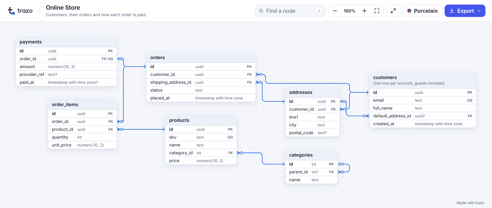
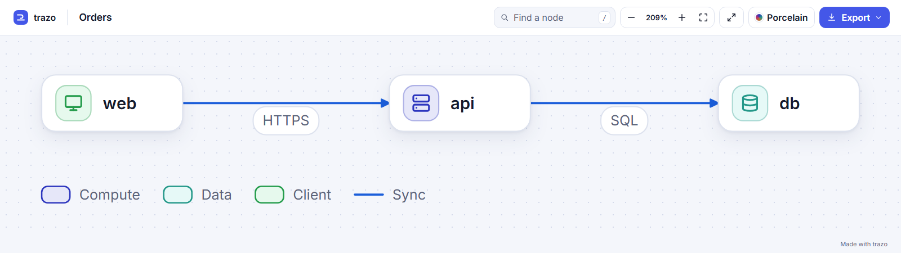
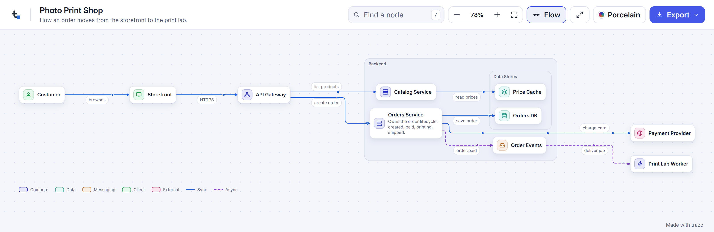
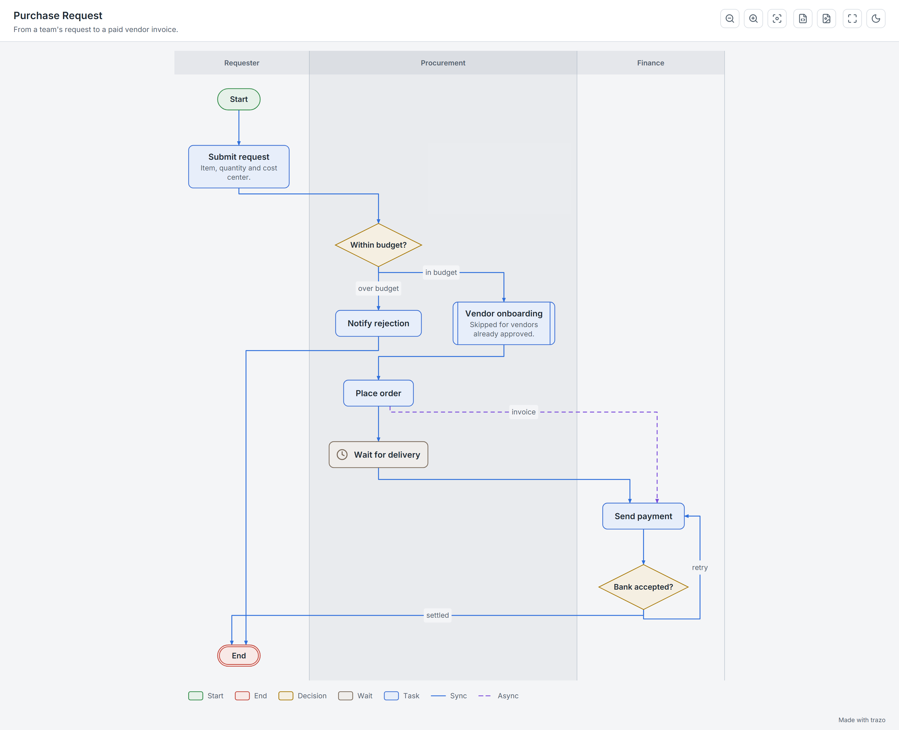
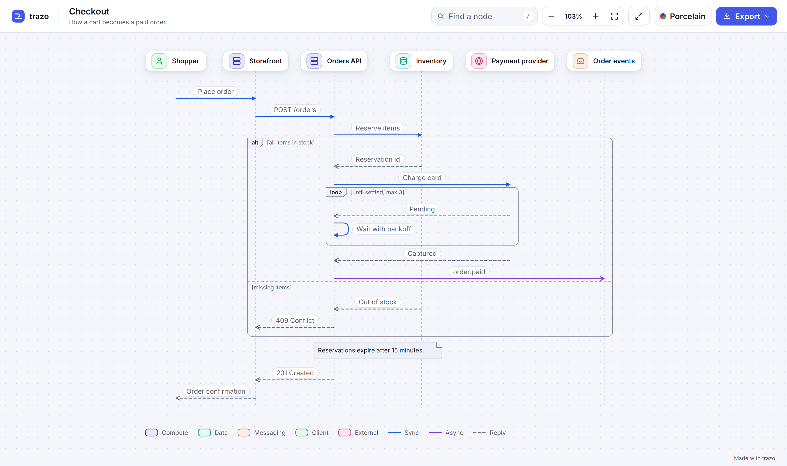

English | [Español](README_ES.md)

# trazo

[](https://github.com/heidenber/trazo/actions/workflows/ci.yml) [](https://www.npmjs.com/package/@heidenber/trazo)

The agent says what is in the system; trazo decides where everything goes.

Write a diagram as semantic JSON, with no coordinates. trazo validates it, lays it out and writes one self-contained HTML file.



## Quick start

You need an agent that can run commands, such as Claude Code, Codex or Pi.

1. Install trazo. Run this in a terminal (it needs [Node.js](https://nodejs.org) 22 or later):

   ```sh
   npm i -g @heidenber/trazo
   ```

2. Optional: install the skill, which tells your agent how to use trazo well. Run `trazo skill install --agent claude` (or `pi`, `codex`; see [Skill for agents](#skill-for-agents)), or ask your agent:

   > Install the trazo skill for yourself, following https://github.com/heidenber/trazo#skill-for-agents

3. Ask your agent for a diagram, for example:

   > Use trazo to draw the architecture of this project. Run `trazo example architecture` to see the format, write the JSON, run `trazo make` and tell me where the HTML file is.

   Open the HTML file in your browser. To change the diagram, ask the agent again.

The other types are `workflow`, `erd` and `sequence` (see [Diagram types](#diagram-types)).

## Demo

`demo.json`:

```json
{
  "type": "architecture",
  "title": "Orders",
  "nodes": [{ "id": "web", "kind": "client" }, { "id": "api" }, { "id": "db", "kind": "database" }],
  "edges": ["web -> api: HTTPS", "api -> db: SQL"]
}
```

```sh
trazo make demo.json
```



This writes `demo.html` next to the input and prints its path. Open it in a browser: pan, zoom, hover or focus a node to see its whole note and source and highlight its connections, export to SVG or PNG. A node's note is also shown under its label, up to three lines. No server and no network requests. A small "Made with trazo" link sits at the bottom of the page; exported SVG and PNG files do not include it.

## Why not just ask the agent for a diagram?

It can draw one, but it has to place every box, arrow and label itself. In our bench:

- **Hand-written SVG:** 20 of 24 diagrams had overlapping text, labels outside their boxes or edges crossing nodes. It also had the highest token cost: the agent writes the whole drawing as output tokens, the most expensive kind.
- **Mermaid:** cheaper, but 7 of 24 of its diagrams had layout defects.
- **trazo:** the agent only says what is in the system; trazo does the layout, checks the input and renders the same HTML every time. No layout defects in 46 runs, valid on the first try.

Details: [bench/README.md](bench/README.md#baseline-trazo-vs-hand-written-svg-vs-mermaid)

## When to use it

trazo does one job: an agent (or you) describes the diagram, and code lays it out.

- The input has no coordinates, sizes or styles, so there is little to read and little to get wrong. Before writing a diagram, an agent reads `trazo schema` and `trazo example` for its type: about 700 tokens, about 1,100 with the skill (estimated as characters / 4).
- Errors name the exact path in the JSON and carry a hint, so an agent can fix its input from the message. In the recorded agent runs, Claude Sonnet 5.5 got a valid diagram on the first `make` in every run and Claude Haiku 4.5 in 92 to 96% of runs; every run ended with a valid diagram.
- The same JSON always gives the same HTML, byte for byte, with no browser and no network.
- ERD foreign keys point at columns, not only at tables.

Numbers and method: [bench/README.md](bench/README.md). Same bench (Codex, gpt-6-luna, 8 tasks, 3 runs each): Mermaid's token cost was about 35–40% lower than trazo's (output weighted 4 to 8 times input, cached input at a tenth; see the token cost section), and 5 of 24 Mermaid runs needed a fix after a syntax error.

What it does not do:

- Only four types: architecture, workflow, ERD and sequence. Mermaid, PlantUML and D2 cover many more.
- No inline rendering in Markdown. GitHub, GitLab and many editors render Mermaid blocks directly; with trazo you open the HTML or export SVG or PNG from it.
- No editing in the output: change the JSON and run `make` again.
- No Mermaid import, no cloud or brand icons, no explainer pages, no browser check of the result.

Larger agent diagram skills do more of the above. trazo trades that for less to read and a layout that does not depend on the model.

## Install

Node 22 or later:

```sh
npm i -g @heidenber/trazo
```

This installs the `trazo` command. To use trazo as a library in a project, run `npm i @heidenber/trazo` instead.

To install from source:

```sh
git clone https://github.com/heidenber/trazo
cd trazo
npm ci
npm run build
npm i -g .
```

## Commands

| Command | What it does |
|---|---|
| `trazo make <input> [-o, --out <file>] [--theme light\|dark] [--json]` | Validate, lay out and write a self-contained HTML file. |
| `trazo check <input> [--json]` | Validate only; writes nothing. |
| `trazo schema <type>` | Print the compact field reference for a diagram type. |
| `trazo example <type>` | Print a complete example diagram, valid input for `make`. |

`<input>` is a JSON file, or `-` to read stdin. `<type>` is `architecture`, `workflow`, `erd` or `sequence`. Without `-o`, `make` writes `<input>` with a `.html` extension; with `-o -`, or when `<input>` is `-` and there is no `-o`, it writes the HTML to stdout. `--json` prints one JSON line instead of plain text and covers results (`make`, `check`); usage errors (exit 2) are always plain text on stderr.

Nodes are colored by kind (a colored border over a soft tint of it) and edges by style (sync blue, async violet, data teal, reply grey) in both themes; you never write colors in the JSON. A legend under the diagram, inside the SVG so PNG and SVG exports keep it, names the kinds and styles the diagram uses; it is left out when there is only one of each.

Exit codes: 0 ok, 1 invalid input, 2 usage error, 3 internal error.

```sh
trazo example erd | trazo make - -o erd.html
```

## Diagram types

- `architecture`: services, stores, queues and people, grouped in boxes. `trazo example architecture`
- `workflow`: steps and decisions, optionally in lanes. `trazo example workflow`
- `erd`: tables, columns and foreign keys, with crow's foot ends. `trazo example erd`
- `sequence`: messages between participants, with notes and `alt`, `opt` and `loop` fragments. `trazo example sequence`

`trazo schema <type>` prints the fields of each type in about 40 lines.

The bundled examples (`trazo example <type>`) as trazo draws them; the ERD is the image at the top. Click one to see it full size.

<p align="center"><a href="https://github.com/heidenber/trazo/blob/main/docs/architecture-light.png"></a></p>
<p align="center"><a href="https://github.com/heidenber/trazo/blob/main/docs/workflow-light.png"></a></p>
<p align="center"><a href="https://github.com/heidenber/trazo/blob/main/docs/sequence-light.png"></a></p>

## Skill for agents

`skill/` has a short skill that tells an agent to read the code before drawing and draw only what it found, cite each part in `source`, start from `trazo example`, check the JSON and fix errors from the messages. trazo never installs it on its own (no postinstall). After installing the package globally, run one command for your agent, in any shell:

```sh
trazo skill install --agent claude   # ~/.claude/skills/trazo/SKILL.md
trazo skill install --agent pi       # ~/.pi/agent/skills/trazo/SKILL.md
trazo skill install --agent codex    # ~/.agents/skills/trazo/SKILL.md
```

It prints `installed <path>`, or `updated <path>` when an older copy was there; run it again after upgrading trazo. These are the documented user-level locations for each agent; check them against your agent's version. `skill/AGENTS.md` keeps the same text as an `AGENTS.md` block for Codex versions without skills.

## Library

```js
import { check, make } from "@heidenber/trazo";

const result = check(jsonTextOrObject);
// { ok: boolean, issues: Issue[] }

const made = await make(jsonTextOrObject, { theme: "dark" });
// { ok, issues, html?: string }  html is set only when ok is true
```

Both accept JSON text or an already parsed object. `make` also returns geometry warnings in `issues`.

TypeScript users can import `ArchitectureInput`, `WorkflowInput`, `ErdInput`, `SequenceInput`, or their union `DiagramInput` for typed parsed objects. For example:

```ts
import { check, type ArchitectureInput } from "@heidenber/trazo";

const input: ArchitectureInput = {
  type: "architecture",
  title: "Orders",
  nodes: [{ id: "api" }],
};
const result = check(input);
```

These types describe the input, not the normalized diagram. Runtime validation still checks semantic constraints such as references and required non-empty arrays.

The stable part of an `Issue` is `severity`, `code`, `path` and `hint`. The `message` text may change between versions, so do not match on it.
See the [validation issue codes](docs/issue-codes.md) for the full list.

## Performance

Reading cost, build time and output size are measured by a script in this repository. See [bench/README.md](bench/README.md) for what is measured, how to run it and the recorded results.

## Development

```sh
npm test            # unit and CLI tests
npm run gen:check   # generated files are up to date
npm run bench       # deterministic benchmark (needs npm run build)
```

Want to help? Read [CONTRIBUTING.md](CONTRIBUTING.md) and look for issues labeled [good first issue](https://github.com/heidenber/trazo/labels/good%20first%20issue).

## License

trazo is licensed under the Apache License 2.0. Copyright 2026 Heidenber Palacio Garzón. See LICENSE and NOTICE.

Third-party material:
- Lucide icons: ISC License. Icons derived from Feather: MIT License.
- Inter typeface: SIL Open Font License 1.1.
- elkjs: Eclipse Public License 2.0.
- zod: MIT License.

Versions and full texts: THIRD_PARTY_NOTICES.md.
