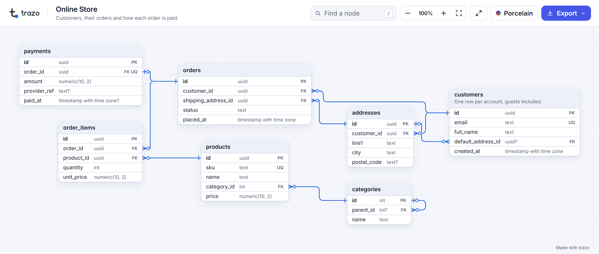
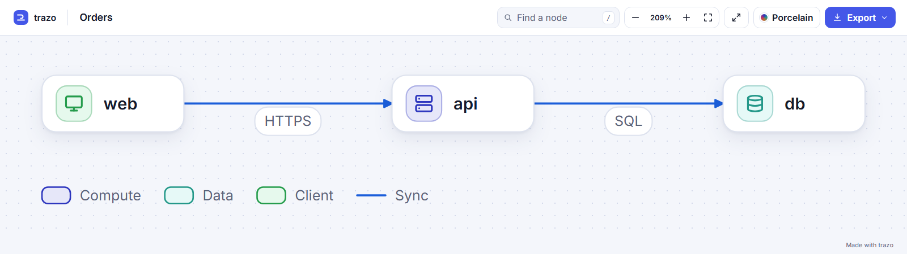
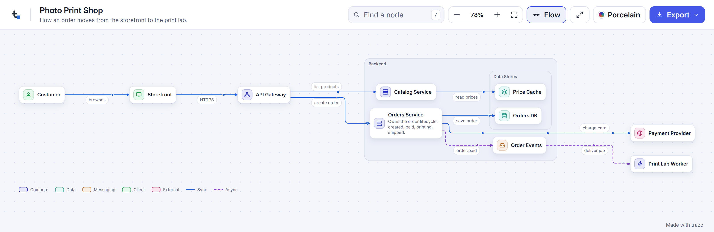
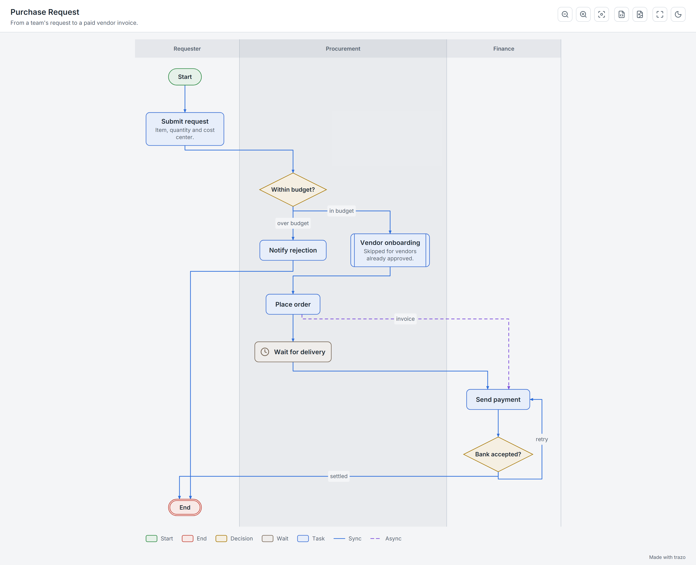
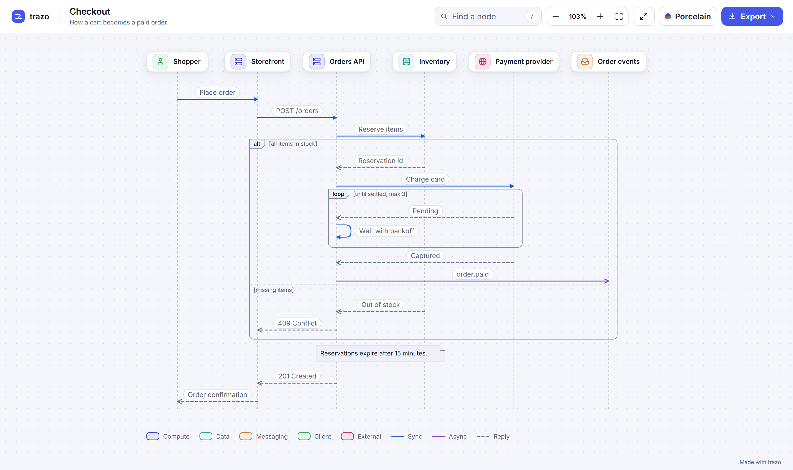

[English](README.md) | Español

<h1>
  <picture>
    <source media="(prefers-color-scheme: dark)" srcset="https://raw.githubusercontent.com/heidenber/trazo/main/docs/logo/trazo-horizontal-reversed.svg">
    
  </picture>
</h1>

[](https://github.com/heidenber/trazo/actions/workflows/ci.yml) [](https://www.npmjs.com/package/@heidenber/trazo)

El agente dice qué hay en el sistema; trazo decide dónde va cada cosa.

Escribes un diagrama como JSON semántico, sin coordenadas. trazo lo valida, lo acomoda y escribe un único archivo HTML autocontenido.



## Inicio rápido

Necesitas un agente que pueda ejecutar comandos, como Claude Code, Codex o Pi.

1. Instala trazo. Ejecuta esto en una terminal (necesita [Node.js](https://nodejs.org) 22 o superior):

   ```sh
   npm i -g @heidenber/trazo
   ```

2. Opcional: instala la skill, que le explica a tu agente cómo usar bien trazo. Ejecuta `trazo skill install --agent claude` (o `pi`, `codex`; consulta [Skill para agentes](#skill-para-agentes)) o pídeselo a tu agente:

   > Instala la skill de trazo para ti, siguiendo https://github.com/heidenber/trazo/blob/main/README_ES.md#skill-para-agentes

3. Pide un diagrama a tu agente, por ejemplo:

   > Usa trazo para dibujar la arquitectura de este proyecto. Ejecuta `trazo example architecture` para ver el formato, escribe el JSON, ejecuta `trazo make` y dime dónde quedó el archivo HTML.

   Abre el archivo HTML en el navegador. Para cambiar el diagrama, vuelve a pedírselo al agente.

Los otros tipos son `workflow`, `erd` y `sequence` (ver [Tipos de diagrama](#tipos-de-diagrama)).

## Demo

`demo.json`:

```json
{
  "type": "architecture",
  "title": "Orders",
  "nodes": [{ "id": "web", "kind": "client" }, { "id": "api" }, { "id": "db", "kind": "database" }],
  "edges": ["web -> api: HTTPS", "api -> db: SQL"]
}
```

```sh
trazo make demo.json
```



Esto escribe `demo.html` junto al archivo de entrada e imprime su ruta. Ábrelo en el navegador: puedes mover y hacer zoom (la barra muestra el nivel de zoom; también funcionan `+`, `-` y `0`), pasar el cursor sobre un nodo (o enfocarlo con el teclado) para ver una tarjeta con su tipo, su nota completa, su origen y sus conexiones (un clic la fija, Esc la cierra), buscar nodos por etiqueta o nota con `/` y moverte con el minimapa. La nota de un nodo también se muestra bajo su etiqueta, hasta tres líneas. El menú de temas cambia entre los cuatro temas dentro de la página y el menú Export ofrece PNG (1x, 2x o transparente), SVG, PDF con el diálogo de impresión (imprime solo el diagrama) y copiar como PNG, SVG o JSON. Las exportaciones usan el tema que estás viendo. Copiar una imagen necesita acceso al portapapeles, que algunos navegadores bloquean en páginas abiertas desde un archivo; el menú lo avisa y puedes descargarla en su lugar. "Copy JSON source" funciona cuando la entrada pesa como máximo 64 KB, porque la página la incrusta como JSON. No necesita servidor ni realiza solicitudes de red. Al pie de la página hay un enlace discreto "Made with trazo"; los archivos exportados, el minimapa y la barra no forman parte del diagrama que exportas o imprimes.

## ¿Por qué no pedirle el diagrama directamente al agente?

Puede dibujarlo, pero tiene que ubicar él mismo cada caja, flecha y etiqueta. En nuestro benchmark:

- **SVG escrito a mano:** 20 de 24 diagramas tenían texto superpuesto, etiquetas fuera de sus cajas o aristas que cruzaban nodos. También fue la opción de mayor costo en tokens: el agente escribe todo el dibujo como tokens de salida, los más caros.
- **Mermaid:** es más barato, pero 7 de 24 de sus diagramas tenían defectos de layout.
- **trazo:** el agente solo dice qué hay en el sistema; trazo hace el layout, valida la entrada y genera siempre el mismo HTML. Ningún defecto de layout en 46 ejecuciones, válido al primer intento.

Detalles: [bench/README.md](bench/README.md#baseline-trazo-vs-hand-written-svg-vs-mermaid)

## Cuándo usarlo

trazo hace una sola cosa: un agente (o tú) describe el diagrama, y el código lo acomoda.

- La entrada no tiene coordenadas, tamaños ni estilos, así que hay poco para leer y poco que pueda fallar. Antes de escribir un diagrama, un agente lee `trazo schema` y `trazo example` de ese tipo: unos 700 tokens, unos 1.100 con la skill (estimado como caracteres / 4).
- Los errores nombran la ruta exacta dentro del JSON y traen una pista, así que un agente puede corregir su entrada a partir del mensaje. En las ejecuciones de agentes registradas, Claude Sonnet 5.5 obtuvo un diagrama válido en el primer `make` en todas las ejecuciones y Claude Haiku 4.5 en el 92 a 96%; todas terminaron con un diagrama válido.
- El mismo JSON siempre da el mismo HTML, byte por byte, sin navegador y sin red.
- Las claves foráneas del ERD apuntan a columnas, no solo a tablas. Los ERD con dos o más tablas también incluyen un overview colapsable dentro del SVG con conteos, relaciones clave e índice de tablas; las exportaciones conservan su estado expandido o colapsado.

Números y método: [bench/README.md](bench/README.md). En el mismo benchmark (Codex, gpt-6-luna, 8 tareas, 3 ejecuciones cada una): el costo en tokens de Mermaid fue entre un 35 y un 40% menor que el de trazo (con la salida ponderada entre 4 y 8 veces la entrada y la entrada en caché a un décimo; ver la sección de costo en tokens), y 5 de 24 ejecuciones de Mermaid necesitaron una corrección tras un error de sintaxis.

Lo que no hace:

- Solo cuatro tipos: arquitectura, workflow, ERD y secuencia. Mermaid, PlantUML y D2 cubren muchos más.
- No se renderiza dentro de Markdown. GitHub, GitLab y muchos editores muestran bloques de Mermaid directamente; con trazo abres el HTML o exportas SVG o PNG desde ahí.
- No se edita en la salida: cambias el JSON y vuelves a ejecutar `make`.
- No importa Mermaid, no trae íconos de nube ni de marcas, no genera páginas explicativas ni revisa el resultado en un navegador.

Las skills de diagramas para agentes más grandes hacen más de esto. trazo lo cambia por menos para leer y un layout que no depende del modelo.

## Instalación

Node 22 o superior:

```sh
npm i -g @heidenber/trazo
```

Esto instala el comando `trazo`. Para usar trazo como librería en un proyecto, ejecuta `npm i @heidenber/trazo` en su lugar.

Para instalarlo desde el código fuente:

```sh
git clone https://github.com/heidenber/trazo
cd trazo
npm ci
npm run build
npm i -g .
```

## Comandos

| Comando | Qué hace |
|---|---|
| `trazo make <input> [-o, --out <file>] [--theme light\|dark\|lagoon\|dusk] [--json]` | Valida, acomoda y escribe un HTML autocontenido. |
| `trazo check <input> [--json]` | Solo valida; no escribe nada. |
| `trazo schema <type>` | Imprime la referencia compacta de campos de un tipo de diagrama. |
| `trazo example <type>` | Imprime un diagrama de ejemplo completo, entrada válida para `make`. |

`<input>` es un archivo JSON, o `-` para leer de stdin. `<type>` es `architecture`, `workflow`, `erd` o `sequence`. Sin `-o`, `make` escribe `<input>` con extensión `.html`; con `-o -`, o cuando `<input>` es `-` y no hay `-o`, escribe el HTML en stdout. `--json` imprime una línea JSON en lugar de texto plano y cubre los resultados (`make`, `check`); los errores de uso (salida 2) son siempre texto plano en stderr.

Cuatro temas: `light` y `dark`, más `lagoon` (claro, turquesa) y `dusk` (oscuro, violeta). Se eligen con el campo JSON `theme` o con `--theme`; el botón de la página alterna entre el tema claro y el oscuro de cada par.

Los nodos son tarjetas suaves con un ícono sobre una pastilla del color del tipo (inicio, fin y decisión llevan relleno y borde teñidos), y las aristas son redondeadas y se colorean por estilo (sync azul, async violeta, data verde azulado, reply gris) en todos los temas; nunca escribes colores en el JSON. Una leyenda bajo el diagrama, dentro del SVG para que las exportaciones PNG y SVG la conserven, nombra los tipos y estilos que usa el diagrama; se omite cuando solo hay un tipo y un estilo.

Códigos de salida: 0 correcto, 1 entrada inválida, 2 error de uso, 3 error interno.

```sh
trazo example erd | trazo make - -o erd.html
```

## Tipos de diagrama

- `architecture`: servicios, almacenes, colas y personas, agrupados en cajas. `trazo example architecture`
- `workflow`: pasos y decisiones, opcionalmente en carriles. `trazo example workflow`
- `erd`: tablas, columnas y claves foráneas, con terminaciones de pata de gallo; los ERD de varias tablas agregan un overview con índice de tablas. `trazo example erd`
- `sequence`: mensajes entre participantes, con notas y fragmentos `alt`, `opt` y `loop`. `trazo example sequence`

`trazo schema <type>` imprime los campos de cada tipo en unas 40 líneas.

Los ejemplos incluidos (`trazo example <type>`) tal como los dibuja trazo; el ERD es la imagen del principio. Haz clic en uno para verlo en tamaño completo.

<p align="center"><a href="https://github.com/heidenber/trazo/blob/main/docs/architecture-light.png"></a></p>
<p align="center"><a href="https://github.com/heidenber/trazo/blob/main/docs/workflow-light.png"></a></p>
<p align="center"><a href="https://github.com/heidenber/trazo/blob/main/docs/sequence-light.png"></a></p>

## Skill para agentes

`skill/` trae una skill corta que le indica al agente que lea el código antes de dibujar y dibuje solo lo que encontró, cite cada parte en `source`, parta de `trazo example`, valide el JSON y corrija los errores a partir de los mensajes. trazo nunca la instala por su cuenta (no hay postinstall). Después de instalar el paquete de forma global, ejecuta un comando para tu agente, en cualquier terminal:

```sh
trazo skill install --agent claude   # ~/.claude/skills/trazo/SKILL.md
trazo skill install --agent pi       # ~/.pi/agent/skills/trazo/SKILL.md
trazo skill install --agent codex    # ~/.agents/skills/trazo/SKILL.md
```

Muestra `installed <ruta>`, o `updated <ruta>` si ya había una copia anterior; vuelve a ejecutarlo después de actualizar trazo. Son las ubicaciones documentadas de nivel de usuario de cada agente; compruébalas con la versión que uses. `skill/AGENTS.md` conserva el mismo texto como bloque de `AGENTS.md` para versiones de Codex sin skills.

## Librería

```js
import { check, make } from "@heidenber/trazo";

const result = check(jsonTextOrObject);
// { ok: boolean, issues: Issue[] }

const made = await make(jsonTextOrObject, { theme: "dark" });
// { ok, issues, html?: string }  html solo viene cuando ok es true
```

Las dos aceptan texto JSON o un objeto ya parseado. `make` también devuelve en `issues` los avisos de geometría.

La parte estable de un `Issue` es `severity`, `code`, `path` y `hint`. El texto de `message` puede cambiar entre versiones, así que no lo uses para comparar.
Consulta la [lista de códigos de validación](docs/issue-codes.md) (en inglés).

## Rendimiento

El costo de lectura, el tiempo de generación y el tamaño de la salida los mide un script de este repositorio. En [bench/README.md](bench/README.md) está qué se mide, cómo ejecutarlo y los resultados registrados.

## Desarrollo

```sh
npm test            # tests unitarios y de CLI
npm run gen:check   # los archivos generados están al día
npm run bench       # benchmark determinista (requiere npm run build)
```

¿Quieres ayudar? Lee [CONTRIBUTING.md](CONTRIBUTING.md) (en inglés) y busca los issues con la etiqueta [good first issue](https://github.com/heidenber/trazo/labels/good%20first%20issue).

## Licencia

trazo se distribuye bajo la Apache License 2.0. Copyright 2026 Heidenber Palacio Garzón. Ver LICENSE y NOTICE.

Material de terceros:
- Íconos Lucide: ISC License. Íconos derivados de Feather: MIT License.
- Tipografía Inter: SIL Open Font License 1.1.
- elkjs: Eclipse Public License 2.0.
- zod: MIT License.

Versiones y textos completos: THIRD_PARTY_NOTICES.md.
